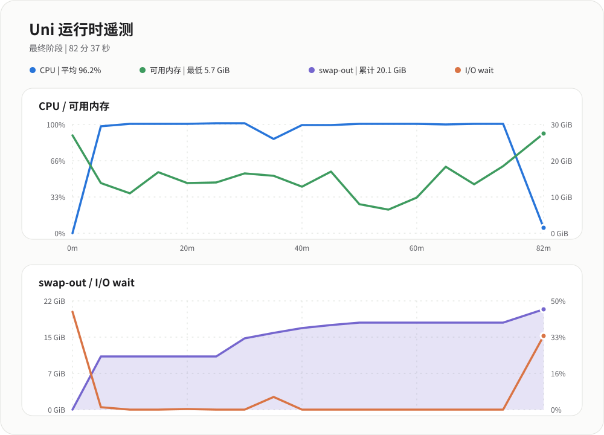

# uni 构建系统

uni 是 Android 构建调度器，使用现有的 Soong、Kati 和 Ninja 构建规则，在其上增加构建图复用、任务排序、资源池和中断恢复。

uni 不改变 Ninja 的依赖关系。普通增量构建仍然根据源码、构建规则和现有产物决定需要执行的任务。

## 构建 Android

在源码根目录初始化环境并选择产品：

```sh
source build/envsetup.sh
lunch uwu_nabu-cp2a-userdebug
uni otapackage
```

uni 会根据构建主机的资源情况自动计算并发数，无需指定 `-j`。

构建单独模块：

```sh
uni SystemUI Settings Launcher3QuickStep
```

重新运行同一目标时，uni 会检查构建图和磁盘产物的复用条件。正常增量构建不需要额外的恢复参数。

## 构建流程

完整构建按以下顺序执行：

1. **准备构建图**：检查产品、release、variant、目标参数、环境和构建系统指纹。条件未变化时复用已保存的 Soong/Blueprint 构建图；否则重新准备构建图。
2. **安排任务**：从 Ninja 图读取目标，结合历史耗时、R8 目标和内核目标决定启动顺序。历史长任务优先安排，R8 任务分散到多个批次。
3. **启动阶段**：优先处理必要的内核和历史长任务。内核链接尽量避开 Kotlin、Java 和 R8 的高内存工作。
4. **主构建**：由 Ninja 执行剩余目标。uni 为 Java、Kotlin、Rust、R8 和其他高内存任务设置各自的资源池，自动调整全局构建并发。
5. **最终阶段**：重新检查构建图状态，然后执行打包、分发及 OTA 目标，记录已完成阶段。

构建中断后，已生成的输出和阶段状态会保留。再次构建时，uni 重新检查磁盘状态，不需要删除 `out`。

## 资源管理

uni 使用 `/proc/meminfo` 的 `MemTotal` 和 `MemAvailable` 计算构建资源预算。

### Soong Go 堆预算

以下变量的单位均为 GiB：

| 变量 | 含义 |
| --- | --- |
| `T` | `MemTotal` |
| `A` | `MemAvailable` |
| `R` | 系统、文件缓存和 Soong 非 Go 堆预留 |
| `H` | 构建进程的活动内存预留 |
| `G` | Go 堆预算 |

```text
R = max(4, 0.25 × T)
H = min(6, max(4, 0.20 × T))
L = T - R

A > H:
    G = min(L, max(A / 2, A - H))
A ≤ H:
    G = A / 2
G ≤ 0:
    G = max(1, T / 2)
```

`G` 不限制整个 `soong_build` 进程的 RSS。Go 堆之外仍可能使用 C/C++ 内存、文件映射和工具链内存。

### 任务资源池

设 `B` 为单任务内存预算，`J` 为 uni 确定的全局并发数，`P` 为资源池并发上限：

```text
P = max(1, min(J, floor((A - 3 GiB) / B)))
```

| 任务类型 | `B` |
| --- | ---: |
| Java | 2 GiB |
| Rust | 2 GiB |
| 其他高内存任务 | 4 GiB |
| R8 | 5 GiB |
| Kotlin | 5 GiB |

Rust 同时考虑 `rustc` 进程和 LLVM codegen units。设每个进程的 codegen units 为 `C`：

```text
Rust 并发上限 = min(P_Rust, ceil(J / C))
```

可以通过以下环境变量覆盖对应资源池的自动计算值：

| 环境变量 | 任务 |
| --- | --- |
| `NINJA_HIGHMEM_NUM_JOBS` | 通用高内存任务 |
| `NINJA_UNI_R8_NUM_JOBS` | R8 |
| `NINJA_UNI_RUST_NUM_JOBS` | Rust |
| `NINJA_UNI_JAVA_NUM_JOBS` | Java |
| `NINJA_UNI_KOTLIN_NUM_JOBS` | Kotlin |

未显式配置时，uni 在构建阶段重新读取 `MemAvailable` 并计算资源池并发。

## 编译缓存与终端

uni 记录 ccache 命中情况，并根据可用磁盘空间管理缓存上限。

交互终端展示 Graph、Kernel、Startup、Main、R8 及内存状态，支持查看构建详情、复制终端内容和中断构建。

## 构建图复用与恢复

正常复用需要检查：

- 产品、release、variant 和目标参数
- Android.bp、Blueprint、Make、Soong 和产品配置指纹
- Ninja 图及输入文件状态
- 构建器版本和相关环境变量

源码或构建规则变化时，使用普通增量构建重新准备受影响的图。

以下参数用于手动控制构建图复用：

| 参数 | 行为 |
| --- | --- |
| `--trust-output` | 跳过恢复输出的新鲜度检查 |
| `--assume-existing` | 接受 Ninja 日志缺失但磁盘上存在的输出，同时启用 `--trust-output` |
| `--force-reuse` | 跳过源码新鲜度检查，强制复用保存的构建图 |

## 常用命令

查看调度计划，不执行 Ninja：

```sh
uni --plan otapackage
```

本次构建重新生成完整 R8 索引：

```sh
uni --dev otapackage
```

持久启用 R8 索引自动刷新：

```sh
uni --dev-auto otapackage
```

清理 uni/Soong 日志，不删除编译产物：

```sh
uni --clean-logs
```

关闭本次详细调试报告：

```sh
uni --no-debug SystemUI
```

## OTA 签名

### 初始化签名密钥

在 Android 源码树中执行：

```sh
uni --init-signing-keys ~/.android-certs
```

密钥目录必须位于源码树之外，且此前不存在。初始化不要求 `lunch`，也不会启动 Android 构建。

生成的基础密钥包括 `bluetooth`、`cyngn-app`、`media`、`networkstack`、`nfc`、`platform`、`releasekey`、`sdk_sandbox`、`shared`、`testcert` 和 `verity`，其中 `testkey` 指向 `releasekey`。

私钥使用未加口令的 PKCS#8 格式。目录权限为 `0700`，密钥文件权限为 `0600`。必须将完整密钥目录备份到独立存储；丢失后重新生成的密钥不能直接代替已发布系统所信任的密钥。

### 生成签名 OTA

完成 `lunch` 后执行：

```sh
uni otapackage --sign-keys ~/.android-certs
```

uni 构建 `target-files-package` 和 `otatools`，使用构建产物中的 `sign_target_files_apks` 和 `ota_from_target_files` 进行签名，不覆盖普通 OTA 产物。

对于 uni 初始化的密钥目录，首次签名时根据 `META/apexkeys.txt` 为非 `PRESIGNED` APEX 创建所需的 4096 位密钥。后续签名复用已有密钥。新增 APEX 可能产生新的密钥文件，备份时应包含 `apex/` 子目录。

签名产物保存到：

```text
OUT_DIR/release/<product>/
```

其中包括 signed target-files、signed OTA 和 `.sha256` 校验文件。

### 自定义 APK 与 APEX 密钥

使用 `--sign-config` 指定 JSON 配置：

```json
{
  "key_mappings": {
    "source/key/path": "custom-key"
  },
  "extra_apks": {
    "com.android.example.apex": "releasekey"
  },
  "extra_apex_payload_keys": {
    "com.android.example.apex": "apex-payload-key.pem"
  }
}
```

相对路径以 `--sign-keys` 指定的目录为基准。APEX payload 私钥须满足对应 APEX 的签名要求，不能使用基础 APK 密钥代替。该配置不会自动替换 AVB 密钥。

```sh
uni otapackage --sign-keys ~/.android-certs --sign-config signing.json
```

### 验证签名

对已有 target-files 执行独立的签名及 OTA 生成检查：

```sh
uni --sign-keys ~/.android-certs --sign-check
```

结果保存在 `OUT_DIR/release/<product>/checks/<timestamp>/`，不启动 Android 构建，也不覆盖普通构建或正式签名产物。

签名模式不能与 `--trust-output` 或 `--assume-existing` 同时使用。

已安装 test-key 系统的设备不能将使用新 release-key 的 OTA 当作普通增量更新。首次更换密钥必须使用信任新密钥的 Recovery、完整 Fastboot 刷入，或经过单独验证的密钥迁移方案。

## 运行时遥测

下图展示 2026 年 9 月 14 日一次 uni 构建最终阶段的运行数据，采样时长为 82 分 37 秒。



图表中的指标包括：

- **CPU**：采样时的处理器使用率。
- **MemAvailable**：Linux 对可用内存的估计值，包含部分可回收缓存。
- **累计 swap-out**：该阶段累计换出的数据量；曲线增长表示发生了新的换出活动。
- **I/O wait**：CPU 等待 I/O 的时间比例。

横轴为经过时间，便于查看构建期间的资源变化。

## 输出与故障排查

构建结束后，uni 输出包含阶段、耗时、内存及输出位置的摘要。

**构建失败时，首先检查 `out/error.log`。** 该文件集中记录构建错误，方便定位失败原因。

如需查看完整输出和调度详情，可继续检查 `OUT_DIR` 中的日志：

```text
uwuCli-output_<timestamp>.log
uwuCli-debug-report_<timestamp>.log
```

修复错误后，直接重新运行 uni 即可继续增量构建。

